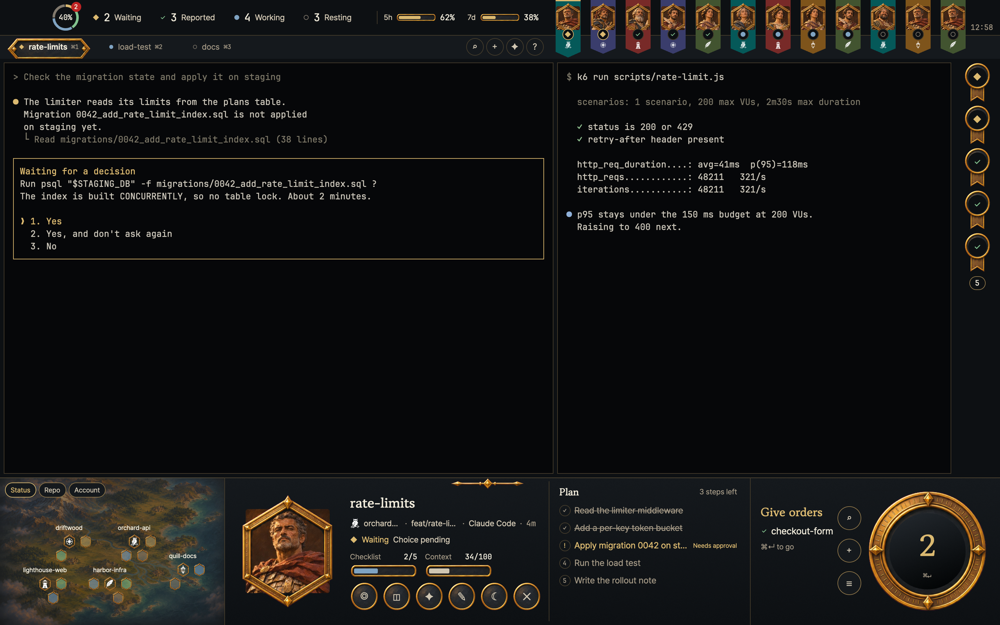

# Regent

A strategy-game style command HUD for [Herdr](https://herdr.dev). The terminals keep the middle of the window while a gold-on-charcoal frame surrounds them: a status ring and four status counts, pennants for the sessions, a hex map of the spaces, a unit card for the selected session and a dial that says what needs doing next.



The screenshot uses made-up sessions and terminals rendered by `tools/preview/render.sh`.

## Add it

Paste this into an agent running in Herdr:

```
Read ~/.config/herdr-app/AGENTS.md, then add this layout: https://github.com/lcalmsky/herdr-regent
```

Or, from a checkout:

```sh
git clone https://github.com/lcalmsky/herdr-regent
cd herdr-regent
./tools/install.sh
```

The script copies `layouts/regent.json` (with its picker picture `layouts/regent.png`) and `mods/regent/` into `${HERDR_APP_HOME:-$HOME/.config/herdr-app}`, merges `layouts/regent.keys.json` into your `keys.json` (after writing a `keys.json.bak-regent-<timestamp>` copy), and runs `herdr-app check` on the mod. Nothing is downloaded and no pictures are generated. Then pick the layout with `layout.switch {name: "regent"}`, or reach it with `ctrl-shift-l`, which cycles through the layouts.

## Before adding it

The mod does more than draw. This is everything it runs, sends and reads:

- **The scan.** Every 3 s the mod runs `sh <appHome>/mods/regent/scan.sh`, which needs `python3`. It runs `ps eww` and `ps -axww` for the session processes and their environments, and `lsof` for each native Codex or Gemini process's working folder. It reads Claude Code's session records and transcripts under `~/.claude` (or `$CLAUDE_CONFIG_DIR`) and under each `~/.claude-accounts/*` that has a `sessions/` folder; Codex rollouts under `~/.codex/sessions`; Gemini chats under `~/.gemini`; the checklist state under `/tmp/deadhd-state` (or `$DEADHD_STATE_DIR`); page alerts under `~/.pulse/pages` (or `$PULSE_PAGES_DIR`); the handoff file and thread notes a session starts from; and the rolling-delivery goals file. It writes only ledger caches under `${TMPDIR:-/tmp}/herdr-pulse` and never opens `*.key` files. The mod uses it for wait reasons, checklists and status times.
- **The account and usage read.** Every 30 s the mod runs `cca --porcelain` (a `sh` script in the mod folder). It reads `~/.claude.json` and `~/.claude-accounts/*/.claude.json`, the current-account and label files under `~/.local/state/herdr-tower/`, the usage records in `~/.local/state/herdr-tower/usage/`, and `~/.codex` / `~/.codex-accounts`. It calls `node` with `models.mjs` and `codex-usage.mjs` from the same folder — this repo does not bundle those two files, so those calls produce nothing. The 5h and 7d gauges read `<name>.json` in the shared usage folder, which is written by a Claude Code status-line hook that this repo does not ship; without such a file the gauges show `—`.
- **The network.** This is the only outbound call: at most every 5 minutes, when `node` and macOS `security` are present, `cca` reads the account's OAuth token from the keychain and `usage-api.mjs` requests `https://api.anthropic.com/api/oauth/usage` for the model's weekly usage. It writes the result to `~/.local/state/herdr-tower/usage/<name>.api.json` and keeps the previous file on failure. `cca` makes that request on its own schedule whether or not this window needs the answer; the 5h and 7d gauges read the local records, not this response. Nothing else here makes a network call.
- **Herdr's `hc`.** The Decision dialog runs `hc read <terminal>`; pressing a number runs `hc keys <terminal> <n>`; Decree runs `hc send <address> <text>` on each chosen session. The mod also runs Herdr commands to focus, split and close panes, select and rename tabs, park a terminal, and create a tab.
- **The layout keys** are delivered to the mod's command loop, which lives in the top bar block.

## Keys

| Key | Command | What it does |
| --- | --- | --- |
| ⌘↵ | `regent.next` | Move to the next Waiting or Reported session, focus it, and open its Decision dialog when it is Waiting |
| ⌘⇧↵ | `regent.read_all` | Mark every Reported session dismissed |
| ⌘K | `regent.find` | Open the Find dialog |
| ⌘T | `regent.found` | Open the New session dialog |
| ⌘⇧E | `regent.decree` | Open the Decree dialog |
| ⌘R | `regent.report` | Open the Report dialog |
| ⌘/ | `regent.help` | Open the Shortcuts dialog |
| ⌘⇧1 | `regent.filter_blocked` | Filter the ribbon to Waiting |
| ⌘⇧2 | `regent.filter_done` | Filter the ribbon to Reported |
| ⌘⇧3 | `regent.filter_working` | Filter the ribbon to Working |
| ⌘⇧4 | `regent.filter_idle` | Filter the ribbon to Resting |
| ⌃⌥P | `regent.toggle` | Give the top bar the keyboard, or hand it back to the terminal |

While the top bar has the keyboard, ← → move the selection, ↵ focuses the selected terminal, `e` opens Decree for it, and Esc returns the keyboard to the terminal. In the dialogs: 1–9, ↵ and Esc in Decision; ⌘↵ in New session and Decree; ↑ ↓, ↵ and Esc in Find. Esc closes every dialog. In Complete, ↵ runs Open report; Report and Shortcuts also have a Close button.

## What you see

- **Top bar** (56 px): a 50 px status ring with the four status counts — Waiting, Reported, Working, Resting — and the 5h and 7d usage gauges. The ring's centre is the checklist percentage, or the session count when no plan has steps, and a red disc counts sessions that have waited three minutes or more. The four counts are clickable filters.
- **Tab rail** (38 px): the active space's tabs, the active one on a plaque, with `⌘N` numbers and four round buttons — Find, New session, Decree, Shortcuts.
- **Ribbon** (720 px): one pennant per session, in its space's colour, with its portrait, status medallion and space sigil; the clock at the right.
- **Terminals** (the middle): the active tab's panes on `#060709` with `#453c2b` borders.
- **Notes** (72 px): one medallion per session waiting on you or reporting back. A click opens it; a right-click dismisses it.
- **Map** (360 px): one hex per session, grouped under its space, coloured by status; a Waiting hex blinks. Three lens pills (Status, Repo, Account) sit at the top left.
- **Unit** (flexible): the selected session's portrait, name, space, branch, program and elapsed time, a checklist bar, six action sockets, and a Plan or Queue column. At 1500 px of its own width and wider it becomes three panels — card, plan or roster, and queue.
- **Dial** (400 px): a heading that reads Give orders, Read reports or All at work, the next session, a large count and three satellite buttons. Clicking the face or pressing ⌘↵ moves to the next session.
- **Dialogs** (640 × 560 or 820 × 600): Decision with numbered choices read from the terminal, Complete, New session, Decree, Find, Report and Shortcuts, each drawn in its own gold frame.

## Files

```
layouts/
  regent.json        the window: nodes, sizes, fonts, pane colours
  regent.keys.json   the layout's key bindings
  regent.png         the 640×400 picture the layout picker shows
mods/regent/
  main.js            role dispatch, polling, commands, dialog keys
  views.js           bar, tabs, ribbon, notes, map, unit, dial
  overlays.js        decision, complete, found, decree, find, report, help
  data.js            parsing and layout maths for the blocks
  source.js          the one place the mod reads Herdr's data
  tokens.js          colours, fonts, status labels, art lists
  scan.sh            the 3 s session scan
  cca                the Claude Code account and usage reader
  usage-api.mjs      the usage fetch cca runs
  mod.json           place none, title, focusable
  assets/            ui frames, portraits, sigils, map and event art
  fonts/             Gowun Batang and Pretendard with their OFL files
  tests/             node tests for data.js with screen fixtures
tools/
  install.sh         copies the layout and mod, merges keys, checks the mod
  merge-keys.py      merges the layout's key section, keeping a backup
  preview/           render.sh, made-up data, stand-in terminal mod
preview.png          2560×1600 gallery picture
CLAUDE.md
LICENSE              MIT
RECIPE.md            the brief to build the layout and mod from scratch
```

## Credits and licences

The art under `mods/regent/assets/` is original, generated for this layout.

The bundled fonts are Gowun Batang and Pretendard, both under the SIL Open Font License 1.1 (`mods/regent/fonts/OFL-GowunBatang.txt`, `OFL-Pretendard.txt`). JetBrains Mono is named by the layout and the mono labels but is not bundled.

`cca` is the Claude Code accounts helper. Its canonical copy lives in the `herdr-claude-accounts` repository, under `mods/claude-accounts/cca`; layout repositories ship copies of it, and this repo carries its own copy alongside `usage-api.mjs`.

## License

MIT for the layout, the `regent` mod, its scripts and the preview tooling (`LICENSE`). The bundled Gowun Batang and Pretendard fonts are under the SIL Open Font License 1.1 (`mods/regent/fonts/OFL-GowunBatang.txt`, `OFL-Pretendard.txt`).
