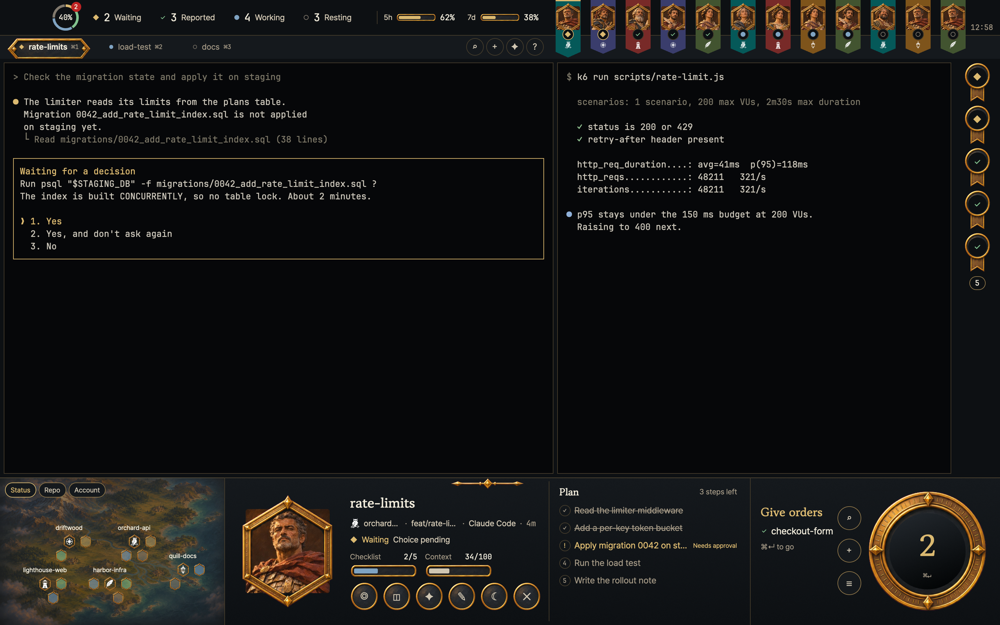

# Regent

A strategy-game style command HUD for [Herdr](https://herdr.dev). The terminals keep the middle of the window while a gold-on-charcoal frame surrounds them: a status ring, four status counts and two usage gauges in the top bar, a tab rail and a ribbon of one pennant per session below it, a column of status medallions down the right of the terminals, and a bottom strip with a hex map of the spaces, a unit card for the selected session and a dial that names what needs doing next.

## What you see

The whole window is one column on a `#0d1013` background, titlebar none, traffic lights at [12, 20], terminal padding [14, 12], not resizable, gap 0. The layout names Pretendard as the UI font and JetBrains Mono as the terminal font. Inside the blocks, body text is Pretendard, session names and headings are Gowun Batang, and numbers, counts and elapsed times are JetBrains Mono.

The palette: paper `#0d1013`, raised paper `#15191d`, selected `#20252a`, rule `#453c2b`, strong rule `#8f7649`, ink `#f1ebdb`, second ink `#d0c6b2`, muted `#a29784`, gold `#dbb970`, dark gold text `#1c1105`, working blue `#7fa3c2`, reported green `#82c38f`, resting grey `#81796d`, error red `#be2323`, terminal `#060709`.

Top to bottom.

- **Head** (94 px row, drags the window): a left column that takes the remaining width, and a fixed 720 px ribbon on the right.
  - **Bar** (56 px, `#0d1013`, 80 px left padding for the traffic lights, 8 px right padding, 10 px gaps). The bar takes a 2 px `#dbb970` bottom border while it has the keyboard.
    - A 50 px status ring: two half-circle tracks in `#20252a` and one 4 px arc per status present, at radius 19 around the centre of a 44 px box, coloured Waiting `#dbb970`, Reported `#82c38f`, Working `#7fa3c2`, Resting `#81796d`, with a 0.08 rad gap between arcs (a single status draws as two halves). Its centre is the checklist percentage in 12 px mono semibold while any session's plan has steps, otherwise the session total in 15 px. The tooltip reads "Waiting N · Reported N · Working N · Resting N", plus " · Checklist N%" when plans have steps. A click opens the Report dialog. When a Waiting session has been Waiting for 3 minutes or more, a 16 px `#be2323` disc with the count in 10 px mono appears on the ring's top-right.
    - Four 32 px status counts side by side, 6 px gaps, 8 px side padding, radius 4: the status glyph in 10 px, the count in 17 px mono semibold `#f1ebdb`, the label in 13 px `#d0c6b2` — Waiting, Reported, Working, Resting. The item under the active filter is `#20252a`; hover is `#15191d`; a click toggles that filter.
    - Two usage gauges near the right of the left column: a 12 px label (`5h`, `7d`), an 88 × 18 px bar drawn from `bar-frame.png` with a gold fill inset 6 % from the left, one third of the bar's height in from the top and bottom, rounded 2 px, and the value in 13 px mono in a 40 px box (`—` when there is no reading). The fill turns `#be2323` above 85 %. Below a 940 px bar the gauges shrink to 64 × 13 px and the value box to 34 px. On a window wide enough that an 880 px strip centred on the whole window (bar width + 720 px ribbon, halved) fits between x 760 and the bar's right edge minus 16, the gauges move there instead, at 128 × 26 px with 20 px gaps, flanked by two 108 × 18 px `divider.png` strips.
  - **Tab rail** (38 px, `#15191d`, 1 px `#453c2b` top rule, 8 px left padding, 2 px gaps). One entry per tab of the active space, 22 px side padding: an 8 px status glyph when the tab has one, the tab name in 13 px (ink semibold when active, muted otherwise), and `⌘N` in 10 px mono. The active tab is drawn with `plaque.png`, inset 2 px on the sides and 4 px top and bottom. Hover is 85 % opacity; a click runs `tab.select`. At the right, 10 px padded, four 28 px round buttons (radius 14, 1 px `#453c2b`, `#15191d`) with 14 px glyphs in `#d0c6b2`, hovering to a gold border and `#20252a`: `⌕` Find session ⌘K, `＋` New session ⌘T, `✦` Decree ⌘⇧E, `?` Shortcuts ⌘/.
  - **Ribbon** (720 × 94 px, `#0d1013`). Its lower 38 px from y 56 is `#15191d`, with a 1 px rule at y 56. One pennant per session, 50 × 94 px, in a scrollable row that stops 52 px short of the right side (4 px left padding, 6 px gaps): a cloth 40 px wide, 86 px tall (92 px when selected) whose colour cycles with the space index through `#055959`, `#782a28`, `#3a3d6c`, `#7e541b`, `#425430`, with a pointed bottom; a 2 px gold bar along the top when selected; the space sigil 12 px at (14, 66) at 85 %; a 46 × 50 px hexagonal portrait window at (2, 4), the 38 × 44 px portrait (or the sigil on `#15191d` for a shell session) under `hex-frame.png`; and an 18 px status medallion at (16, 46), `#0d1013` with a 1 px border — gold when Waiting, gold when selected, rule otherwise — holding the status glyph in 10 px. A click selects the session and focuses its pane; the tooltip is "name: wait reason" for a Waiting session with a reason, else the status label. The clock sits at the top right (right 6, top 34): 12 px mono muted on a 3 px-rounded `#0d1013` plate. With no sessions the row says "No sessions yet." and offers a gold "Start the first session" button with a ⌘T keycap. After three failed scans in a row it says "Session scan failed 3 times in a row. Terminals still work." in red and offers "Scan again".
- **World** (the remaining height): the active tab's terminals and a notes column.
  - The terminal block fills the width: `#060709` panes, radius 0, 6 px gaps, 1 px `#453c2b` border and a 1 px `#453c2b` focus border, `lone: true`.
  - **Notes** (72 px, `#0d1013`, 6 px vertical padding, 4 px gaps, centred, scrolls): one 46 × 64 px medallion per queued session — Waiting sessions first, longest wait first, then Reported — drawn from `medallion.png` with a 30 px `#0d1013` disc at (8, 8) holding the status glyph in 13 px. A click selects the session, focuses its pane and opens the Complete dialog (the Decision dialog when it is Waiting). A right-click dismisses it. A count pill after the last medallion (22 px tall, 26 px minimum wide, radius 11, 1 px `#8f7649`) shows how many are listed; a right-click on it dismisses all of them.
- **Hud** (236 px row, `#0d1013`).
  - **Map** (360 px, 1 px `#453c2b` right border), drawn on a vertical gradient from `#15191d` to `#0d1013` with a 1 px `#8f7649` rule at half opacity along the top. `map.jpg` fills 360 × 240 px at y −2 at 50 % opacity. Three lens pills at (8, 8) with 4 px gaps — Status, Repo, Account — are 24 px tall, 8 px padded, radius 12, `#15191d`, bordered gold on the selected one and `#8f7649` otherwise, with 11 px labels. Status: one group per space as before; Repo: one group per git repository, `No repo` for sessions outside one; Account: one group per Claude account, `Other` for none; the group head hex shows the sigil picked from the group's key (the space id, the repo name or the account name) and the name, and a click selects the group's first Waiting or Reported session. Spaces are placed into five fixed groups of hex slots; each group starts with a 24 × 24 px space hex holding the space sigil in 14 px, with the space name in 10 px in a 92 px box above it (or below when the name would collide) and a `+N` overflow count in gold next to it. After it come up to 4, 4, 3, 3 or 2 session hexes (the group sizes), each 22 × 22 px: a 16 px rounded square in the status colour at 55 % opacity under `hex-frame.png`. A Waiting hex blinks between 45 % and 100 % opacity every 1400 ms. Clicking a session hex selects it; clicking the space hex selects the group's first Waiting or Reported session. Groups are ordered by any Waiting session, then any Reported session, then the selected session's space, then count, and only the first five are drawn; a `+N` pill at the bottom right counts the hidden spaces. Group overflow beyond the slots is a gold `+N`.
  - **Unit** (flexible width), on the same gradient, with a 1 px `#8f7649` rule along the top and a divider image centred at the top. While the unit block is narrower than 1500 px it is one row (20 px gaps, 20 px side padding, 6 px vertical padding): a 160 × 184 px hex portrait, an information column, and a side column 36 % of the width clamped to 300–720 px (420 px before a width is known) behind a 1 px left rule. The information column is the session name in Gowun Batang bold, 26 px (22 px below 1100 px), then a 13 px meta row — 16 px sigil, space name, branch or tab name, program name or address, elapsed time in mono — then the status row: 11 px glyph, 13 px label (gold when Waiting), and the detail (the wait reason for a Waiting session, else the title when it differs from the name). A checklist bar (108 × 22 px frame, label `Checklist`, value `done/total` in 12 px mono) appears when the plan has steps, filled with `#7fa3c2`; a second bar for `Context` appears when a context percentage exists, gold above 70. Below them, six 46 px action sockets drawn from `socket.png` with 17 px glyphs: `◎` Go to terminal ↵ (focuses the pane), `◫` Open beside ⌘D (focuses the pane then splits right), `✦` Send decree e (opens the Decree dialog for this session), `✎` Rename F2 (`tab.rename`), `☾` Rest (`terminal.park`), and `✕` End session (first click arms it and draws a red circle around a `!`, the second closes the pane). The side column is headed `Plan` with "N steps left" and up to six 26 px plan rows when the session has a plan; otherwise `Queue` with "N decisions · N reports" and up to six 28 px queue rows (status glyph, name in 14 px, the subtitle — wait reason, or a distinct title, or "Report in" — and the wait time at the right in 12 px mono). Narrow side columns drop the subtitle.
    - At 1500 px of unit width and wider the unit becomes three columns: a fixed 764 px left column with the portrait and information column, a flexible middle, and a right column that takes the rest, split symmetrically about the window axis when the middle stays at least 600 px wide and the right column at least 520 px, otherwise evenly. The middle is headed `Plan` again with its steps, or, without a plan, `Working N · Resting M` above chips for every Working and Resting session — 50 px tall, a 40 × 46 px portrait, the name in 14 px, a status glyph and "space · elapsed" in 12 px, three rows of at least 250 px chips (up to 360 px for long names) with a `+N` chip for the rest. The right column is always `Queue`, headed "N decisions · N reports" (and "top 5 shown" when longer), with up to five 34 px rows: a 26 × 30 px portrait, a status glyph, the name in a 230 px box, the wait time in a 48 px mono box, and the subtitle.
    - With no session at all the unit says "No sessions." in the centre.
  - **Dial** (400 px, 1 px `#453c2b` left border, same gradient). At (16, 40) a 118 px column: a 19 px Gowun Batang bold gold heading — `Give orders` while anything is Waiting, `Read reports` while anything is Reported and nothing is Waiting, `All at work` otherwise — then the next session (10 px status glyph and its name in 15 px) with "⌘↵ to go" in 12 px, or "No one is waiting". Three 38 px round satellite buttons at right 222, tops 46, 98 and 150: `⌕` Find ⌘K, `＋` New session ⌘T, `☰` Report ⌘R. The dial face is a 196 × 196 px `dial-bezel.png` at right 18, top 20, over a 122 px circle filled with a gradient from `#20252a` to `#030506`, holding the Waiting count in 48 px gold, or the Reported count in green, or `Calm` in 20 px, with `⌘↵` in 11 px mono below. A click on the face runs the same next action as ⌘↵.

## How it behaves

**Statuses.** Herdr's four agent statuses are renamed in the interface:

| Herdr status | Label | Glyph | Colour |
| --- | --- | --- | --- |
| blocked | Waiting | ◆ | `#dbb970` |
| done | Reported | ✓ | `#82c38f` |
| working | Working | ● | `#7fa3c2` |
| idle | Resting | ○ | `#81796d` |

A Waiting session's reason comes from the scan: `dialog open` reads "Choice pending", `input needed` reads "Input needed", any other text is shown unchanged, and no reason reads "Waiting for orders". A Reported session's detail is its title when that differs from the session name. Working and Resting sessions carry no queue entry.

**Selection.** Blocks read `regent.sel`, which holds an agent address. When that address is gone the selection falls back to the focused agent's session, then to the first session in the action queue, then to the first session. Selecting a pennant, note, map hex or queue row also focuses that session's pane (`pane.focus`).

**The action queue.** Waiting sessions come first, oldest wait first by the scan's status time, then Reported sessions. The dial skips the Reported sessions the reader dismissed. The notes column hides any entry the reader dismissed there, Waiting or Reported, and only while the session still has the status it was dismissed with; the unit's Queue lists the same queue unfiltered. The bar's four counts read the whole session list, ignoring filters and dismissals.

**Next action (⌘↵).** It closes whichever dialog is open, selects the queue entry after the current selection (wrapping), focuses its pane and opens the Decision dialog when that session is Waiting. With an empty queue it does nothing. The dial face runs the same function.

**Reports and dismissal.** A Reported session stays in the notes column and the queue until it is dismissed. Right-clicking its note stores its address and status under `regent.dismissed`; right-clicking the count pill dismisses every note currently listed; ⌘⇧↵ marks every Reported session in the whole list dismissed. Opening a note's dialog does not dismiss it. A dismissed session reappears if its status changes.

**Filters.** The bar's four counts, and ⌘⇧1 to ⌘⇧4 (`blocked`, `done`, `working`, `idle`), toggle one status under `regent.filter`. The active filter is drawn on the counts and narrows the ribbon pennants to that status; the other blocks keep showing everything. Pressing the same filter again clears it.

**The bar and the keyboard.** The bar is the only copy of the mod that polls data and receives the mod's commands. Ctrl-Alt-P focuses the bar (and turns on its gold bottom border), or hands the keyboard back to the terminals with `pane.go {direction: "down"}` when the bar already has it. While the bar has the keyboard, ← and → move the selection through the status-sorted session list, ↵ focuses the selected pane, `e` opens the Decree dialog for the selected session, and Esc hands the keyboard back. Herdr's own focus landing on the bar arrives as the command `focus` and focuses its keyboard handle.

**Scan failures.** The bar runs the scan every 3 s and counts consecutive failures. At three the ribbon shows the red failure line and a "Scan again" button, which writes `regent.retry`; the bar notices the new value and rescans with the counter reset.

**Dialogs.** Each opens with `openOverlay({kind: "dialog", frame: "none", modal: false})`: 640 × 560 px for Decision, Complete, New session and Decree; 820 × 600 px for Find, Report and Shortcuts. They draw their own `#0d1013` frame with a 1 px `#8f7649` border, radius 6, one 40 px `corner.png` at the top-left, a heading in 20 px Gowun Batang bold with a 12 px subline and a 200 × 12 px divider, and a 52 px footer with a 1 px top rule holding a 12 px muted hint and buttons 32 px tall (primary gold with `#1c1105` text, quiet on `#0d1013`, the rest on `#15191d`). Esc closes all seven; in Complete, ↵ runs Open report. Report and Shortcuts take the keyboard like the other dialogs — their root element tracks the dialog's focus handle and forwards key-down to the overlay key handler — and keep their Close button. The currently open one's id is kept in `regent.panel`.
- **Decision** (`event/decision.jpg` header 120 px; heading "name: waiting for a decision", subline "space, program, waiting time"). It reads the terminal's screen with `hc read`. While reading it says "Reading the terminal…". It parses the numbered choices at the bottom of the screen; if it cannot, it says so and shows the last twelve non-frame lines in 12 px mono on `#060709`. Otherwise it shows the question in 14 px and each choice as a 46 px row — a 30 px socket image with the number in 13 px gold mono, the label in 14 px, and a keycap — and pressing 1–9 or clicking a row sends that number to the terminal with `hc keys` and closes. ↵ focuses the terminal and closes; "View in terminal" does the same; "Later" closes.
- **Complete** (`event/complete.jpg` header 120 px; "Task complete: name", "space, all N checklist steps done"). The body is the session's wait reason, else its title, else "A report is in." in 15 px. The "Open report" button focuses the terminal and "Continue" closes; Esc also closes, and ↵ runs Open report too.
- **New session** (`art/founding.jpg` header 120 px; "New session"). A scrollable Space row of 36 px chips with sigils (the active space preselected), an Agent row — Claude Code, Codex, Gemini, Shell only, with portraits, where the three programs start `claude`, `codex` and `gemini` — and a three-row "First instructions" textarea. "Create" (⌘↵) runs `tab.new` with the chosen space, program and task text; "Cancel" closes.
- **Decree** (no header art; "Decree", "Send the same instructions to the chosen sessions"). A list of every session with a 16 px checkbox (all Waiting sessions preselected), a 24 × 28 px portrait, the name, space and status glyph, and a 76 px instructions textarea. "Send" (⌘↵) runs `hc send` on each chosen session except Waiting ones, which are skipped and named, then shows a notification ("Decree: Sent to N…") and closes. The footer says working sessions take it after their current reply.
- **Find** (820 × 600; a 52 px header with a 48 px text field, placeholder "Search sessions, spaces and commands"). It lists matching sessions under "Sessions" (36 px rows with portrait, name, space, status glyph) and the commands New session, Send decree, Report and Shortcuts under "Commands", both filtered by the query and sessions sorted by status. ↑ and ↓ move, ↵ selects the session and focuses its pane or opens the command, Esc closes. With no matches it says `No sessions match “query”`.
- **Report** (820 × 600; "Today's record"). Three clickable tabs. By session is selected on open (underlined gold); By space and By account group the same per-session minutes by space (space name and session count) and by Claude account (the account folder name under `~/.claude-accounts`, `default` for the primary one, `Other` for sessions without one, such as Codex and Gemini); a group row shows the portrait of its first session and `name (count)`. A legend for Working time (`#7fa3c2`), Waiting time (`#dbb970`) and Unread report time (`#82c38f`), then up to fourteen rows sorted by minutes, each a 26 × 30 px portrait, the name in a 130 px box, a 14 px stacked bar in those three colours scaled to the longest row, and the minutes in 11 px mono. The "Close" button closes it, and Esc closes it too; the `esc` keycap on the button is a real key binding.
- **Shortcuts** (820 × 600; "Shortcuts"). Three columns: Everywhere, When the decision dialog is open, When the HUD has the keyboard (⌃⌥P), each a label with keycaps. The footer reads "⌃ combos the terminal programs use are never taken".

**Keys.**

| Key | Command | What it does |
| --- | --- | --- |
| ⌘↵ | `regent.next` | Close the open dialog, move to the next Waiting or Reported session, focus its pane, and open its Decision dialog when it is Waiting |
| ⌘⇧↵ | `regent.read_all` | Mark every Reported session dismissed |
| ⌘K | `regent.find` | Open the Find dialog |
| ⌘T | `regent.found` | Open the New session dialog |
| ⌘⇧E | `regent.decree` | Open the Decree dialog |
| ⌘R | `regent.report` | Open the Report dialog |
| ⌘/ | `regent.help` | Open the Shortcuts dialog |
| ⌘⇧1 | `regent.filter_blocked` | Filter the ribbon to Waiting |
| ⌘⇧2 | `regent.filter_done` | Filter the ribbon to Reported |
| ⌘⇧3 | `regent.filter_working` | Filter the ribbon to Working |
| ⌘⇧4 | `regent.filter_idle` | Filter the ribbon to Resting |
| ⌃⌥P | `regent.toggle` | Give the bar the keyboard, or hand it back to the terminal |

Inside the dialogs: 1–9, ↵ and Esc in Decision; ↵ and Esc in Complete; ⌘↵ in New session and Decree; ↑ ↓, ↵ and Esc in Find. Esc closes every dialog; Report and Shortcuts take the keyboard the same way as the others (their root element tracks the dialog's focus handle and forwards key-down to the overlay key handler) and also have a Close button.

**Hover and motion.** Rows, chips and queue entries hover to `#15191d`; the selected row is `#20252a`; pennants fade to 92 % and quick buttons and sockets to 85 %; round, dialog and quick buttons turn their border gold. A Waiting map hex blinks its opacity between 45 % and 100 % every 1400 ms. The clock repaints every 20 s; the focus border checks the bar's focus every 250 ms. Colour changes are instant — gpui-kit animates only opacity, size and position.

## Built from

- `layouts/regent.json`: root `column` (theme colours inline, background `#0d1013`, titlebar none, traffic lights [12, 20], font JetBrains Mono, ui_font Pretendard, terminal padding [14, 12], not resizable, gap 0, `"preview": "layouts/regent.png"`):
  - `head` row (px 94, `window_drag`): `head-left` column (weight 1) with `bar` (px 56, `regent` `{role: "bar"}`) and `tabs` (px 38, `{role: "tabs"}`), plus `ribbon` (px 720, `{role: "ribbon"}`);
  - `world` row (weight 1): `main` block (`tab: "active"`, pane background `#060709`, 1 px `#453c2b` border and focus, radius 0, gap 6, `lone: true`) and `notes` (px 72, `{role: "notes"}`);
  - `hud` row (px 236, `#0d1013`): `map` (px 360, `{role: "map"}`), `unit` (weight 1, `{role: "unit"}`) and `dial` (px 400, `{role: "dial"}`).
- `layouts/regent.keys.json`: the `layout:regent` section above.
- `mods/regent/`: one mod with seven in-layout roles (`bar`, `tabs`, `ribbon`, `notes`, `map`, `unit`, `dial`) and seven dialog roles (`decision`, `complete`, `found`, `decree`, `find`, `report`, `help`). `mod.json` is `{ "place": "none", "title": "Regent HUD", "focusable": true }`. Files: `main.js` (role dispatch, timers, the command loop, dialog key handling), `views.js` (the seven in-layout roles and `nextAction`), `overlays.js` (the seven dialogs), `data.js` (pure parsing and layout maths), `source.js` (the only place the mod reads Herdr's data), `tokens.js` (colours, fonts, status labels, asset lists), `scan.sh`, `cca` and `usage-api.mjs`.
- `herdr` functions used: `agents`, `spaces`, `shared`, `setShared`, `setAgentOrder`, `nextCommand`, `exec`, `hc`, `run`, `notify`, `appHome`, `props`, `openOverlay`, `closeOverlay`. The ring, pennants and dial face are drawn with `PathBuilder` and `window.paint_path`.
- Commands run: `pane.focus`, `pane.split`, `pane.close`, `pane.go`, `tab.select`, `tab.new`, `tab.rename`, `terminal.park`.
- Shared state, all prefixed `regent.`: `regent.data` (the scan's per-session plan, wait reason, start time, status time and scan error count, plus usage), `regent.sel`, `regent.filter`, `regent.dismissed`, `regent.panel`, `regent.retry`, and `regent.size.<role>` (each block publishes its measured size; the bar reads `regent.size.ribbon`, the unit reads `regent.size.map` and `regent.size.dial`).
- Data: `source.js` is three one-line reads — `agents()`, `spaces()` and `shared("regent.data")`. `main.js` in the bar role merges them through `data.js` and publishes a session's `plan`, `waitingFor`, `startedAt`, `statusUpdatedAt` and (always null) `context`; it also hands Herdr a status-sorted address order with `setAgentOrder`.
- Programs: the bar runs `exec("sh", [appHome + "/mods/regent/scan.sh"])` every 3 s and `exec(appHome + "/mods/regent/cca", ["--porcelain"])` every 30 s, and polls for focus every 250 ms. The Decision dialog runs `hc read <terminal>`; answering runs `hc keys <terminal> <n>`; Decree runs `hc send <address> <text>` per target. `scan.sh` is a `sh` wrapper that needs `python3`; it runs `ps eww`, `ps -axww` and `lsof` and reads Claude Code session records and transcripts, Codex rollouts and Gemini chats, the checklist state, page alerts, handoff files and thread goals (paths in `scan.sh`); it writes only ledger caches under `${TMPDIR:-/tmp}/herdr-pulse` and never opens `*.key`. `cca` reads account files and usage records under `~/.local/state/herdr-tower/usage/`; at most every 5 minutes, when `node` and macOS `security` exist, `usage-api.mjs` fetches `https://api.anthropic.com/api/oauth/usage` with the keychain token and writes `<name>.api.json`. No other code here reaches the network.
- `mods/regent/assets/`: `ui/` (9 images: badge, bar-frame, corner, dial-bezel, divider, hex-frame, medallion, plaque, socket), `portrait/` (8 jpg: scholar, architect, navigator, scribe, envoy, general, astronomer, merchant), `sigil/` (12 png: owl, tower, compass, lantern, quill, anchor, key, mountain, ship, sun, tree, wheat), `art/` (3 jpg: founding, map, terrace) and `event/` (4 jpg: complete, decision, rest, working). The art is original, generated for this layout. Portraits, sigils and pennant colours are picked by hashing the session address or space id, so they stay stable.
- `mods/regent/fonts/`: Gowun Batang Regular and Bold, Pretendard Regular, Medium, SemiBold and Bold, with `OFL-GowunBatang.txt` and `OFL-Pretendard.txt`, both the SIL Open Font License 1.1. JetBrains Mono is named by the layout and by the mono labels but is not bundled.
- Tools: `tools/install.sh` copies `layouts/regent.json` and `layouts/regent.png` and the mod folder into `${HERDR_APP_HOME:-$HOME/.config/herdr-app}`, merges the key section with `tools/merge-keys.py` (writing a backup first) and runs `herdr-app check`. `tools/preview/render.sh` regenerates `preview.png` (2560 × 1600) and `layouts/regent.png` (640 × 400) from made-up data.

**Regenerating the pictures.** `./tools/preview/render.sh` needs `/Applications/Herdr.app`, `rsync`, `python3`, `ffmpeg` and the `herdr-app` CLI. It refuses to run while the screen is locked (or when `ioreg` cannot be read): a hidden Herdr instance draws nothing behind a lock. It copies the installed app home into a temp folder, installs this repo's mod, replaces `source.js` with `tools/preview/source.demo.js` (twelve made-up sessions in five made-up spaces), adds `tools/preview/mods/regent-demo-term` as a stand-in terminal that draws a fake decision and load-test screen, clears the `regent.*` shared keys, writes a 1600 × 1000 window, launches Herdr hidden, takes a shot with `herdr-app shot`, kills the instance it started and scales the shot to the two pictures with `ffmpeg`. `--keep` keeps the work folder.

## Watch out

- **The Context bar never appears.** The unit draws it when a session's `context` is a number, but the bar publishes `context: null` for every session.
- **Some tooltips and help rows name Herdr's own default keys, not this layout's keys file.** The unit's ⌘D and F2 tooltips and the help sheet's ⌘[ / ⌘], ⌃1–⌃9 and ⌘1–⌘9 are bound by Herdr's defaults, so they go stale if the person rebinds them.
- **The bar is the only copy with the command loop and the scan.** Key commands are delivered to the mod's `nextCommand`, which is consumed by the bar copy; the other six copies only draw. A missing or renamed `bar` block stops every shortcut.
- **The map can drop a leading prefix from space names.** The map block reads an optional `strip` prop (`{"role": "map", "strip": "team-"}` in the layout); a space name that starts with it is drawn without it, and every other name shows in full. The shipped layout sets no prefix.
- **Sizes are in pixels chosen for a wide window.** The unit switches to three columns at 1500 px of its own width; the map holds at most five space groups with 4/4/3/3/2 session slots; the unit's Queue shows at most six rows and the wide three-panel queue five; the report shows fourteen; Report, Find and Shortcuts are fixed at 820 × 600 and the other dialogs at 640 × 560.
- **The scan and `cca` assume more than this repo ships.** `scan.sh` only treats Claude Code records with `entrypoint === "cli"` and a live pid as sessions, and needs `python3`; native Codex and Gemini sessions need `ps` and `lsof`. `cca` calls `models.mjs` and `codex-usage.mjs` from its own folder, which this repo does not bundle, so those paths silently produce nothing. The 5h/7d gauges read `<name>.json` in the shared usage folder, written by a status-line hook this repo does not ship; without those files the gauges show `—`. The only network call is `usage-api.mjs`.
- **`cca` writes outside the mod folder**: the usage record under `${XDG_STATE_HOME:-$HOME/.local/state}/herdr-tower/usage/`. The scan writes only its cache under `${TMPDIR:-/tmp}/herdr-pulse`.
- **The install copy is not a symlink.** `install.sh` copies the whole mod folder, including the 26 MB of fonts and `tests/`, and only skips the copy when the installed folder is already a symlink to this checkout.
- **JetBrains Mono is not bundled.** A machine without it falls back to Herdr's default monospace.
- **Four shipped images are not drawn**: `ui/badge.png`, `art/terrace.jpg`, `event/rest.jpg` and `event/working.jpg`.

## Done when

- `node --test tests/data.test.mjs` in `mods/regent/` passes (it imports only `data.js` and its fixtures, so it needs no Herdr).
- `herdr-app check mods/regent` prints its pass line.
- `layout.switch {name: "regent"}` shows the bar, tab rail and ribbon over the terminals, the notes column on the right, and the map, unit and dial along the bottom; `ctrl-shift-l` cycles away and back without errors.
- A Claude Code session appears as a pennant in the ribbon within 3 s of starting; its status count in the bar and its glyph on the pennant match its state, and a session waiting on a permission prompt shows ◆ Waiting with its reason.
- Clicking a pennant or a note selects that session, focuses its pane, and fills the unit card with its name, space, branch, program and elapsed time.
- A Waiting session's note opens the Decision dialog with the terminal's question and numbered choices; pressing a number sends it and the dialog closes.
- ⌘↵ moves to the next Waiting or Reported session and opens the Decision dialog on a Waiting one; ⌘⇧↵ empties the notes column of Reported sessions and the dial's count follows.
- ⌘⇧1 to ⌘⇧4 highlight one bar count and narrow the ribbon; pressing the same one clears the filter.
- ⌘K lists sessions and commands and ↵ opens the highlighted one; ⌘T creates a tab in the chosen space with the chosen program; ⌘⇧E sends text to the chosen sessions; ⌘R and ⌘/ open at 820 × 600; Esc closes every dialog, ↵ in Complete runs Open report, and Report and Shortcuts also have a Close button.
- Ctrl-Alt-P focuses the bar (2 px gold bottom border) and Ctrl-Alt-P again returns the keyboard to the terminal.
- `./tools/preview/render.sh` regenerates both pictures and refuses with a message while the screen is locked; the opened pictures show only the made-up sessions.
